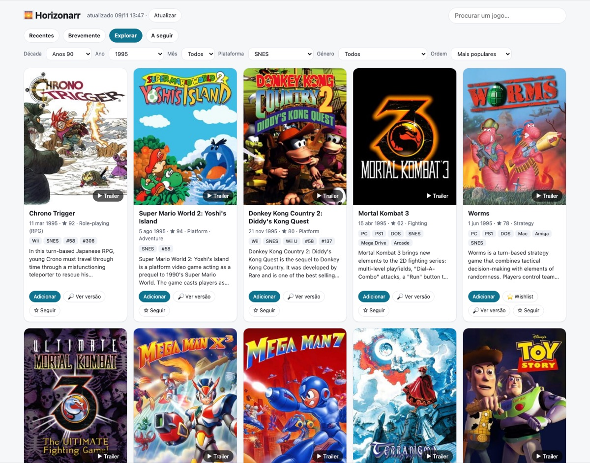

# 🌅 Horizonarr

**New, upcoming and classic games in one page, with whether you can already get them and a one-click add to [RetroArr](https://github.com/RiDDiX/RetroArr).**

*[Português](README.pt.md)*



Horizonarr is a small self-hosted companion for a game *arr stack. It answers "what came out, what's coming, and what's worth getting?":

- **Recent** (last 30 days) and **Upcoming** (next 90 days) for PC, Mac, Switch, Switch 2, PlayStation, Xbox and retro systems, sorted by hype or by date.
- **Explore any era**: pick a decade, year and month, a system (from Atari 2600 to PS5), a genre, and sort by popularity or rating. Chrono Trigger on SNES in 1995 is two clicks away.
- **For you**: games IGDB lists as similar to the ones you own in RetroArr, most mentioned first, each with the owned game that suggested it.
- **Calendar**: upcoming releases day by day, filterable by system and genre, or only the games you follow.
- **Explore filters**: theme (horror, sci-fi, open world…), game mode (co-op, split screen, multiplayer…) and minimum rating.
- **Search** any game by name.
- On every game you get:
  - cover, synopsis, genres and rating;
  - a **trailer** when IGDB has one;
  - Steam price in your currency.

  A detail page adds screenshots, every video, developers, publishers and release dates.
- **🟢 Available**: a paced background job asks your **Prowlarr** indexers whether a release exists, with size and seeders. It runs one search a minute with a daily budget, so indexers don't rate-limit you. A **🔎 Check** button looks up any game on demand.
- **Library badges** from RetroArr: 📚 *I have it*, ⏬ *downloading 45%*, ⭐ *wishlist*, 👁 *being searched*. You can also hide what you already own.
- **Add** sends a game to RetroArr as *monitored*, on the right platform and in a "Novidades" collection, and RetroArr's sweep downloads it when a good release shows up. **⭐ Wishlist** adds Steam games to RetroArr's wishlist with a price watch.
- **Follow** games and get **ntfy** pushes when they come out, become available or get cheaper on Steam, plus a weekly digest.

Only the Python standard library is used, there is no build step, and the image is small. The UI is in Portuguese for now; contributions for other languages are welcome.

## Quick start

1. Create a free Twitch developer app at <https://dev.twitch.tv/console> (any name, redirect `https://localhost`). Its Client ID and Secret give access to IGDB.
2. Copy `.env.example` to `.env` and fill in at least `IGDB_CLIENT_ID` and `IGDB_CLIENT_SECRET`. RetroArr, Prowlarr and ntfy are optional, and each one switches on its own features.
3. `docker compose -f docker-compose.example.yml up -d`, then open `http://<server>:2730`.

| Variable | What for |
|---|---|
| `IGDB_CLIENT_ID`, `IGDB_CLIENT_SECRET` | **required**: release data |
| `RETROARR_URL`, `RETROARR_API_KEY` (or `RETROARR_API_KEY_JSON`) | badges, Add, Wishlist |
| `RETROARR_DB`, `RETROARR_STEAM_FOLDER` | optional: wishlist entries skip the empty folder RetroArr makes for each new game |
| `PROWLARR_URL`, `PROWLARR_API_KEY` | 🟢 availability |
| `AVAILABILITY_PER_DAY`, `AVAILABILITY_GAP_SECONDS` | pace of indexer searches (default 150/day, 60 s apart) |
| `NTFY_URL`, `NTFY_TOPIC`, `NTFY_TOKEN` | push notifications |
| `COUNTRY` | Steam price country (default `PT`) |
| `REFRESH_HOUR`, `DIGEST_WEEKDAY`, `DIGEST_HOUR` | daily refresh hour, weekly digest day (0 = Monday) and hour |

Every variable can also be read from a file with `VAR_FILE`, Docker-secrets style.

## Security

There is no login. Keep it on your LAN or behind a VPN such as Tailscale, or put a reverse proxy with authentication in front of it. **Don't expose it to the internet as is**: the buttons can add games to your RetroArr.

## Development

```sh
python -m unittest discover -s tests
ruff check horizonarr tests
IGDB_CLIENT_ID=... IGDB_CLIENT_SECRET=... DATA_DIR=./data PORT=8099 python -m horizonarr
```

Game data comes from [IGDB](https://www.igdb.com) and prices from the Steam store. Horizonarr does not host, link to or provide any content; it only reads what your own indexers report.

MIT licensed.
