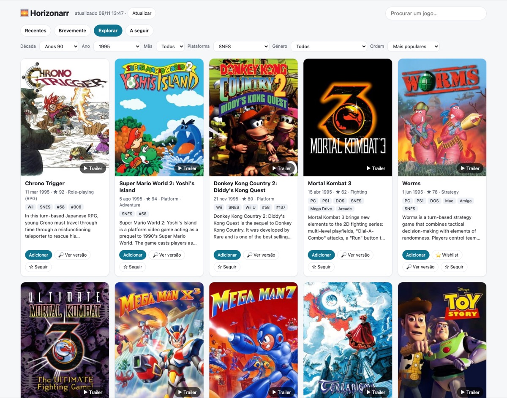

# 🌅 Horizonarr

**Jogos novos, por sair e clássicos numa só página. Mostra se já os podes descarregar e adiciona-os ao [RetroArr](https://github.com/RiDDiX/RetroArr) com um clique.**

*[English](README.md)*

- **Recentes** (últimos 30 dias) e **Brevemente** (próximos 90 dias), para PC, Mac, Switch, Switch 2, PlayStation, Xbox e sistemas retro.
- **Explorar qualquer época:** escolhes a década, o ano, o mês, o sistema (do Atari 2600 à PS5) e o género, e ordenas por popularidade ou por nota.
- **Para ti:** jogos parecidos com os que tens no RetroArr, com o jogo teu que deu origem a cada sugestão.
- **Calendário:** os lançamentos dia a dia, com filtros, ou só os jogos que segues.
- **Filtros no Explorar:** tema (terror, ficção científica, mundo aberto…), modo (cooperativo, ecrã dividido…) e nota mínima.
- **Pesquisa** por nome.
- **Em cada jogo:**
  - capa, sinopse, géneros e nota;
  - **trailer**, quando o IGDB tem um;
  - preço Steam.

  A página de detalhe acrescenta capturas de ecrã, todos os vídeos, produtoras e datas de lançamento.
- **🟢 Disponível:** pergunta aos teus indexers do **Prowlarr** se há versão. Faz uma pesquisa por minuto, com limite diário, para os indexers não te bloquearem. O botão **🔎 Ver versão** pesquisa qualquer jogo na hora.
- **Selos da biblioteca (RetroArr):** 📚 Tenho, ⏬ A descarregar, ⭐ Wishlist, 👁 À procura. Há também um filtro para esconder o que já tens.
- **Adicionar:** mete o jogo no RetroArr como *monitored* e na coleção "Novidades", e o RetroArr descarrega-o quando houver versão boa. **⭐ Wishlist:** junta os jogos Steam ao wishlist do RetroArr, com alerta de preço.
- **Seguir:** avisos no **ntfy** quando o jogo sai, fica disponível ou baixa de preço, e um resumo semanal.

A configuração está no [README em inglês](README.md#quick-start) e no `.env.example`. Só é obrigatória uma app grátis da Twitch, que dá acesso ao IGDB.

**Não tem login.** Usa-o só na rede local ou por VPN (por exemplo o Tailscale).
